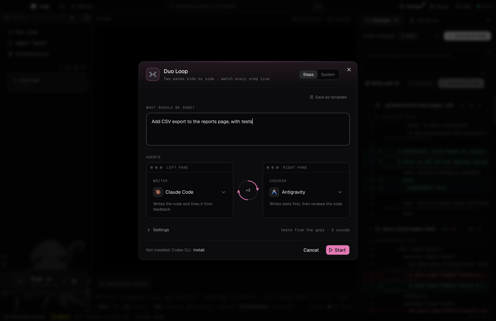

<p align="center">
  
</p>

<h1 align="center">Vulgr</h1>

<p align="center">
  An open-source terminal for working with AI coding agents.<br />
  Run Claude Code, Codex and AGY side by side, keep your sessions organized, and let agents check each other's work.
</p>

<p align="center">
  <a href="https://vulgr.tech">vulgr.tech</a> ·
  <a href="https://github.com/vulgrs/vulgr/issues">Issues</a> ·
  <a href="LICENSE">MIT License</a>
</p>

<p align="center">
  
</p>

## Download

Download it from [vulgr.tech](https://vulgr.tech), which picks the right file for your computer, or grab it from [Releases](https://github.com/vulgrs/vulgr/releases):

- `Vulgr-<version>-arm64.dmg` — macOS, Apple Silicon
- `Vulgr-<version>-x64.dmg` — macOS, Intel
- `Vulgr-Setup-<version>.exe` — Windows
- `Vulgr-<version>-x86_64.AppImage` — Linux (`chmod +x` it, then run it)

Beta builds are not code-signed with an Apple or Microsoft certificate yet, so the system warns the first time. On macOS, move Vulgr to Applications, open it once, then go to **System Settings → Privacy & Security** and click **Open Anyway** (or run `xattr -dr com.apple.quarantine /Applications/Vulgr.app`). On Windows, choose **More info → Run anyway**.

**Updates:** Vulgr checks for new versions at launch and every few hours and downloads them in the background; a gift icon next to your profile (bottom left) then restarts into the new version. This works on macOS, Windows and Linux (AppImage); on macOS the app must be in a folder it can write to, such as Applications.

Or install it with npm and start it with `vulgr`:

```bash
npm install -g vulgr@beta
vulgr
```

## Features

- **Real terminals** — xterm.js + node-pty, so agent TUIs, colors and prompts work as they do in your normal terminal.
- **Split panes** — open terminals side by side or stacked; every pane has its own command box.
- **Sessions and groups** — tabs name themselves after the work done in them (or stay *Untitled*), can be renamed, dragged into groups, and are restored on the next launch. Split tabs list their panes in the sidebar.
- **Command box** — run commands as blocks with duration and output, describe a command in plain words with `#`, or ask Claude with `?` / `Ctrl+Shift+Enter`.
- **Agents working together**
  - **Duo Loop** — two panes side by side: the checker writes tests from your goal, the writer codes until they pass.
  - **Agent Swarm** — give one goal; test-writer, coder and reviewer agents run it in the background, optionally in an isolated git worktree.
  - **Orchestrator** — give a big goal; a planner splits it into tasks, several agents do them at the same time (each in its own worktree, with tests), the parts are merged and tested together, a reviewer checks the whole change and the result lands in your working tree. From a terminal: `orchestrate orchestra "<goal>" -w claude,agy`.
  - **Claude Chat** — talk to Claude Code and watch its file changes live.
- **Changes, report, memory** — review the diff and commit & push, export the session as Markdown/HTML/JSON, and keep project rules the agents always receive.
- **GitHub sign-in**, **dark / light theme**, **English / Turkish** interface.

## Requirements

- macOS, Windows or Linux
- [Node.js](https://nodejs.org) 20 or newer
- Build tools for the native terminal module (`node-pty`): Xcode Command Line Tools on macOS, the "Desktop development with C++" workload on Windows
- The agent CLIs you want to use, installed and signed in: [Claude Code](https://docs.anthropic.com/en/docs/claude-code), Codex CLI, AGY / Gemini CLI

## Getting started

```bash
git clone https://github.com/vulgrs/vulgr.git
cd vulgr
npm install
npm run build      # compile the Electron main process and the UI
npm run dev:app    # start the UI dev server and the app
```

`npm run start:app` runs the last build without the dev server.

## Development

| Command | What it does |
| --- | --- |
| `npm run dev:app` | Vite dev server + Electron, with hot reload for the UI |
| `npm run build` | Type-check and build everything into `dist/` |
| `npm run dist:mac` / `npm run dist:win` / `npm run dist:linux` | Package the app into a DMG / Windows installer / AppImage under `release/` |
| `npm run type-check` | Type-check the main process and the UI |
| `npm test` | Run the engine tests (after `npm run build`) |

Releases are built by GitHub Actions: bump `version` in `package.json`, then push a matching tag (`git tag v0.2.0-beta && git push origin v0.2.0-beta`). `.github/workflows/release.yml` builds the macOS, Windows and Linux installers and attaches them, with the update files, to the GitHub Release for that tag.

Project layout:

- `electron/` — main process: windows, terminals (`ptyManager.ts`), GitHub sign-in, IPC
- `src/` — engine shared by the app: agent adapters, Agent Swarm (`engine/agentMesh.ts`), Orchestrator (`engine/orchestra.ts`), git and worktree helpers, tests
- `ui/` — React interface; translations live in `ui/src/i18n/messages/`

## Website

[vulgr.tech](https://vulgr.tech) is built from `docs-site/` (plain HTML/CSS) and published to GitHub Pages by `.github/workflows/pages.yml`.

## Code Signing Policy

Free code signing on Windows is provided by [SignPath.io](https://signpath.io/), certificate by [SignPath Foundation](https://signpath.org/).

- **Committers and Reviewers:** [Vulgr contributors](https://github.com/vulgrs/vulgr/graphs/contributors)
- **Approvers:** [Vulgr maintainers](https://github.com/orgs/vulgrs/people)

## Privacy Policy

This program will not transfer any information to other networked systems unless specifically requested by the user or the person installing or operating it.

Vulgr runs locally on your machine. Terminal sessions, project files, and preferences stay on your computer. Network requests occur only when checking GitHub Releases for updates or when you explicitly sign in with GitHub or run AI coding agent CLIs that you have configured.

## Contributing

Issues and pull requests are welcome. For larger changes, please open an issue first so we can agree on the approach. When adding interface text, add it to both the English and Turkish tables in `ui/src/i18n/messages/` — the type-check fails if one is missing.

## License

[MIT](LICENSE) © Vulgr contributors
